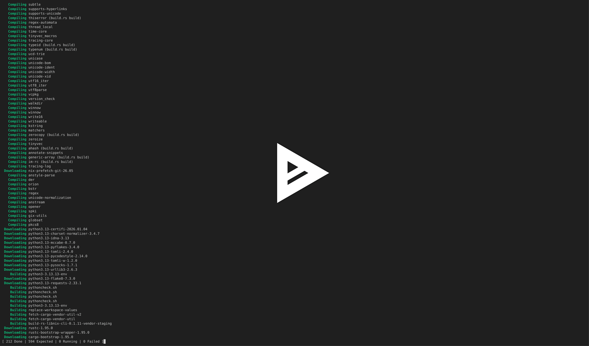

# WARNING ⚠️

This is an unofficial fork of Cargo — not endorsed by the Rust Project.

This fork is intended as a PR to contribute this to the official cargo project and to engineer the solution and to get feedback on the work from the nix community.

# What is this?

This project integrates nix as a build backend into cargo (libnix), so you get the advantages of nix during development and deployment. The detailed technical status is in [README-DEV.md](README-DEV.md).

Ideally you type these commands: 🚀

```
nix develop github:nixcloud/cargo
export CARGO_BACKEND=nix 
cargo build
```

[](https://asciinema.org/a/1268068)

The nix backend is switched on with the environment variable `CARGO_BACKEND=nix` the devshell above sets it. Without it, or with any other value, this cargo behaves like the upstream cargo (legacy).

## How it works

cargo resolves the dependencies and plans the build as usual. In nix mode it then writes one nix derivation per unit (a crate with its features and profile, a build script, a build script run, a test harness) to _target/&lt;profile&gt;/nix_, builds them with `nix build` and links the results into _target/&lt;profile&gt;_, so `target/debug/<bin>` is a symlink into `/nix/store`.

* every crate is built in the nix sandbox, with its system libraries from `Cargo.dependencies.nix`
* crates.io downloads and crate builds are store paths, shared between projects and machines (and between `cargo build`, `cargo run` and `cargo test`)
* the same nix code can be exported with `cargo build write-nix-buildsystem` and built by nix alone, from a flake or nixpkgs, without calling cargo again

### build scripts and build-rs-libnix

cargo (legacy) runs a `build.rs`, reads the `cargo:` directives it prints (`rustc-cfg`, `rustc-link-lib`, `rustc-env`, …) and applies them to the rustc calls that follow. In nix mode the build script run is a derivation of its own, and the units built after it can't ask cargo anything, so the parsing happens inside that derivation: its output goes through [build-rs-libnix](https://github.com/nixcloud/build-rs-libnix), a small CLI that writes the result to `$out/nix` (`rustc-arguments` for the crate itself, `rustc-propagated-arguments` for the crates linking it, `environment-variables`, e.g. `DEP_<LINKS>_<KEY>`), which the dependent derivations read.

* the generated `build_rs_libnix.nix` builds it from a pinned commit of nixcloud/build-rs-libnix; the 1.87 and the 1.99 line pin the same version, as the `cargo:` protocol didn't change between them
* every build script run depends on it, so changing the pin rebuilds all build script runs and everything after them; fixes go to nixcloud/build-rs-libnix first and each branch bumps its pin in one step
* not supported yet (planned for 0.1.13): the `cargo::` syntax (Rust ≥ 1.77) and old-style `cargo:KEY=VALUE` metadata other than `include`, `root`, `conf`, `version_number` and `static` are skipped with a warning; `metadata`, `rustc-flags` and `rustc-link-arg-{bin,bins,tests,examples,cdylib}` fail the build script run

## Requirements

* nix with the `nix-command` and `flakes` features, a running nix-daemon and the sandbox enabled (the defaults on NixOS)
* Linux; developed and tested on x86_64-linux
* `rustc` of the same version as the cargo (currently 1.87.0), the devshell and flake provide both
* `nix-prefetch-git` in `PATH` only for vendored git dependencies (`cargo vendor`, part of the devshell); other git dependencies come from cargo's own checkout (nixcloud/cargo#10)

# Supported subcommands and features 🧰

With `CARGO_BACKEND=nix`, the build-related subcommands go through nix; all others are plain cargo. Details and the state of development are in [README-DEV.md](README-DEV.md).

| subcommand | nix mode | notes |
|---|---|---|
| `build` | ✅ | every unit is built in nix; `build write-nix-buildsystem` exports the build system for flakes and nixpkgs |
| `run` | ✅ | binaries and examples; `std::env::current_exe()` is the binary in the store |
| `test` | ✅ | unit, integration and doc tests; the tests run outside of nix, the sources at `env!("CARGO_MANIFEST_DIR")` are read-only |
| `clean` | ✅ partial | the target directory or a profile, together with the store paths it rooted; `clean -p` and `clean gc` are refused |
| `check` | ❌ planned | refused with "not supported yet" |
| `install`, `uninstall` | ✅ | binaries stay in the store, rooted in `<root>/nix/install`, `<root>/bin` links to them; uninstall deletes the store paths nothing else uses |
| `doc`, `rustdoc`, `rustc`, `bench`, `package`, `vendor` | ❌ | refused with "not supported yet" |
| `new`, `init`, `add`, `remove`, `update`, `fetch`, `generate-lockfile`, `tree`, `metadata`, `fmt`, `publish`, … | unchanged | vanilla cargo, the backend is not involved |
| `fix` | ❓ | untested, it builds in check mode internally |

| feature | state | notes |
|---|---|---|
| crates.io dependencies | ✅ | downloaded and built in `/nix/store`, shared between projects and machines |
| path dependencies, workspaces, `-p`, `--features` | ✅ | |
| build scripts (`build.rs`), proc macros | ✅ | build scripts run in the nix sandbox |
| `cargo:` directives of build scripts | ⚠️ | parsed by build-rs-libnix; `cargo::` syntax, generic metadata, `rustc-flags` and the target-specific `rustc-link-arg-*` are not supported yet, see [build scripts and build-rs-libnix](#build-scripts-and-build-rs-libnix) |
| system libraries, environment variables | ✅ | per crate in `Cargo.dependencies.nix`, see [Injecting dependencies](#injecting-dependencies) |
| git dependencies | ✅ | downloaded once, by cargo, and added to the nix store as the `pkgs.fetchgit` output (submodules included); vendored ones need `nix-prefetch-git` |
| vendored sources, source replacement | ✅ | |
| `--offline` | ✅ | crates.io is served from the store tarballs of `Cargo.lock`, so the build system can be generated inside a nix build (IFD) |
| `--release` | ✅ | profile options (`lto`, `codegen-units`, `panic`, …) are passed on, but untested |
| GC roots | ✅ | per selection of units in `target/<profile>/nix/gc`, the 8 most recent are kept; `cargo clean` removes them |
| cargo-like output | ✅ | nix logs are shown in cargo's format |
| other registries | ❌ | only crates.io; others fail when the build system is generated |
| incremental builds / fingerprints | ❌ | changed crates are always compiled from scratch, so iterating is slower than with cargo (legacy) ([#3](https://github.com/nixcloud/cargo/issues/3)) |
| cross-compilation, `--target` (e.g. wasm) | ❓ | untested, known failures (wasm) |
| platforms | ❓ | developed and tested on x86_64-linux only, Darwin is untested |
| toolchain | ⚠️ | `rustc` and `cargo` must have the same version (currently 1.87.0) |

## Regression tests

[test.nix](test.nix) builds the projects of [#18](https://github.com/nixcloud/cargo/issues/18) at pinned revisions with this cargo and runs their binaries; `tests-libnix/run.sh` writes a `RESULTS.md`. Currently 30 of 31 projects pass with rustc 1.87.0 (2026-10-19, with build-rs-libnix 0.1.12; codex, leptos, mdBook, sniffnet, starship, typst and wasmtime are pinned to their last release before they needed a newer rustc). union fails: it needs a nightly rustc (`#![feature]`). `cargo:rustc-link-arg` (`tikv-jemalloc-sys`) is supported since build-rs-libnix 0.1.12. For the 1.99 line, see [master-libnix](https://github.com/nixcloud/cargo/tree/master-libnix). Some projects need a `Cargo.dependencies.nix`, see [tests-libnix](tests-libnix).

# Using cargo (libnix)

There are three ways to use cargo (libnix):

1. **devshell**: try it without changing anything
2. **flake**: add it to your project's devshell
3. **traditional nix code**: `shell.nix`, NixOS configuration, …

## 1. devshell

```bash
nix develop github:nixcloud/cargo
cargo build
```

This adds `cargo` (libnix), a matching `rustc` and `nix-prefetch-git` to your environment and sets `CARGO_BACKEND=nix`.

## 2. flake

Add the cargo (libnix) binary and the matching `rustc` to your project's devshell:

```nix
{
  description = "myproject";

  inputs = {
    nixpkgs.url = "github:NixOS/nixpkgs/nixos-26.05";
    libnix-flake.url = "github:nixcloud/cargo";
    flake-utils.url = "github:numtide/flake-utils";
  };

  outputs = { self, nixpkgs, flake-utils, libnix-flake }:
    flake-utils.lib.eachDefaultSystem (system:
      let
        pkgs = import nixpkgs { inherit system; };
      in {
        devShells.default = pkgs.mkShell {
          buildInputs = [
            libnix-flake.packages.${system}.rustc_1_87_vanilla_pin
            libnix-flake.packages.${system}.cargo-libnix-1_87_0_plus_v4
            pkgs.nix-prefetch-scripts
          ];
          shellHook = ''
            export CARGO_BACKEND=nix
          '';
        };
      });
}
```

Afterwards check that `cargo` is the one from the store:

    $ which cargo
    /nix/store/…-cargo-0_88_0-bin-8cad88ffd54a16db/bin/cargo

## 3. traditional nix code

A `shell.nix` that builds cargo (libnix) from the build system of release `libnix-1.87.0+v4` with a pinned rustc/cargo 1.87.0 from [fenix](https://github.com/nix-community/fenix):

```nix
{ pkgs ? import <nixpkgs> { } }:
let
  fenix = import (builtins.fetchTarball {
    url = "https://github.com/nix-community/fenix/archive/6ed03ef4c8ec36d193c18e06b9ecddde78fb7e42.tar.gz";
    sha256 = "1mjmp9c5x3j6jqy50ymr07nxl4nrlp3iininxhnzc1ragdrg8pxn";
  }) { inherit pkgs; };
  toolchain = fenix.toolchainOf {
    channel = "1.87.0";
    sha256 = "sha256-KUm16pHj+cRedf8vxs/Hd2YWxpOrWZ7UOrwhILdSJBU=";
  };
  # the generated build system of cargo (libnix) and the cargo sources it builds
  buildsystem = builtins.fetchTarball {
    url = "https://github.com/nixcloud/cargo/releases/download/libnix-1.87.0%2Bv4/libnix-1.87.0+v4.tar.bz2";
    sha256 = "sha256:0zhj8sl05g861c7pkwgd1ij26mf68qj1flbad2ivwj113vac9chq";
  };
  cargo-src = builtins.fetchTarball {
    url = "https://github.com/nixcloud/cargo/archive/refs/tags/libnix-1.87.0%2Bv4.tar.gz";
    sha256 = "sha256:0lm951801chcdnjni4068jjwlzyf94byjgjk5qzlr9vihsp5i3ym";
  };
  cargo-libnix = (import (buildsystem + "/derivations/default.nix") {
    inherit pkgs;
    project_root = cargo-src;
    external_crate_dependencies = import (buildsystem + "/Cargo.dependencies.nix") { inherit pkgs; };
    rustc = toolchain.rustc;
    cargo = toolchain.cargo;
  }).cargo-0_88_0-bin-8cad88ffd54a16db;
in
pkgs.mkShell {
  packages = [ cargo-libnix toolchain.rustc pkgs.nix-prefetch-scripts ];
  shellHook = "export CARGO_BACKEND=nix";
}
```

For a NixOS configuration, put `cargo-libnix` and `toolchain.rustc` into `environment.systemPackages` instead and set `CARGO_BACKEND=nix` in `environment.variables`.

# Injecting dependencies

Crates that link against system libraries (`openssl-sys`, `libsqlite3-sys`, …) or need environment variables at build time get them from a `Cargo.dependencies.nix` next to `Cargo.toml` / `Cargo.lock`. Without the file, crates are built with the toolchain only; a `*-sys` crate whose build script can't find its library is the typical sign that an entry is missing.

1. create `Cargo.dependencies.nix` in the workspace root
2. add `buildInputs` per crate in `deps` and environment variables per crate in `envs`; the name and version are the ones in `Cargo.lock`. The version is optional, but once a crate is keyed by version, `deps` must list every version of it in `Cargo.lock`:

    ```nix
    { pkgs }:
    with pkgs;
    {
      deps = {
        "openssl-sys" = [ pkg-config openssl ];       # every version
        "libsqlite3-sys" = {
          "0.30.1" = [ pkg-config sqlite ];           # only this version
        };
      };
      envs = {
        "proc-macro-test" = {
          "PROC_MACRO_TEST_LOCATION" = "";
        };
      };
    }
    ```

3. run `cargo build`; the inputs and variables are added to every derivation of that crate (build script, build script run, compilation)

More examples are in [Cargo.dependencies.nix](Cargo.dependencies.nix) (the one of cargo itself) and in [tests-libnix](tests-libnix).

# Exporting the build system

`cargo build` writes the nix code to _target/&lt;profile&gt;/nix_ on every run. `cargo build write-nix-buildsystem` writes the same code to a directory of your choice, without building, so your project can be built by nix alone: from a flake, nixpkgs or another project.

```
   ┌─────────────────┐
   │  flake.nix      │
   └────────┬────────┘
            │
            ▼
┌────────────────────────────┐
│  nix build system          │
│  • cargo_build_caller.nix  │
│  • derivations/default.nix │
│  • derivations/ ...        │
└───────────┬────────────────┘
            │
            ▼
┌───────────────────────┐
│  project source code  │
│  • src/               │
│  • Cargo.toml / ...   │
└───────────────────────┘
```

The project's own crates either come from a directory (the default, the `project_root` argument) or from a tarball given with `--url` and `--hash`. For a release of your project, e.g. tag `v1.0.0` on GitHub:

1. tag the release and push it
2. get the hash of the source tarball:

    ```bash
    nix-prefetch-url https://github.com/<owner>/<project>/archive/refs/tags/v1.0.0.tar.gz
    ```

3. write the build system:

    ```bash
    CARGO_BACKEND=nix cargo build --release write-nix-buildsystem \
      --out-dir ./nix \
      --url https://github.com/<owner>/<project>/archive/refs/tags/v1.0.0.tar.gz \
      --hash <hash from step 2>
    ```

4. test it: `nix build --file nix/cargo_build_caller.nix target -L`
5. publish it: commit the directory to your repository, or attach a tarball of it to the release (as cargo (libnix) does, see its [releases](https://github.com/nixcloud/cargo/releases))

The build system has two entry points:

1. `cargo_build_caller.nix` is self-contained: it pins its own nixpkgs and rustc/cargo 1.87.0 (from fenix, without `rust-src`, which would end up in the runtime closure of every binary), so build artifacts can be shared between machines, and reads `Cargo.dependencies.nix` from `project_root`. It takes `system` and `project_root` (default: its own directory)
2. `derivations/default.nix` is for flakes and other nix code: you pass `pkgs`, `rustc`, `cargo`, `external_crate_dependencies` and `project_root` yourself, see [traditional nix code](#3-traditional-nix-code) and this repository's [flake.nix](flake.nix)

Both return an attribute set with a derivation per unit (e.g. `cargo-0_88_0-bin-8cad88ffd54a16db`) and `target`, which links all root units like _target/&lt;profile&gt;_.

# Branches and releases 🌿

cargo (libnix) does not follow every upstream cargo release, only selected Rust toolchains. Each supported toolchain is a patch stack on top of upstream's release of that toolchain.

| branch | what it is |
|---|---|
| `master-libnix` | the main line, on the newest supported toolchain (currently Rust 1.99.0) |
| `rust-<version>-libnix` | one maintenance branch per supported toolchain, e.g. `rust-1.87.0-libnix`; mirrors upstream's `rust-<version>` branch |
| `master` | upstream cargo, untouched |

The naming follows upstream: cargo has a release branch per toolchain (`rust-1.87.0`, `rust-1.99.0`) and tags the cargo crate version (`0.88.0` is the cargo of Rust 1.87.0, `0.100.0` the one of Rust 1.99.0).

Releases are tags named after the toolchain plus a libnix revision: `libnix-1.87.0+v1`, `libnix-1.87.0+v2`, … The tags stay valid no matter what happens to the branches; flakes and nix code should pin a tag or a release tarball, not a branch.

## releasing

1. bump [LIBNIX_RELEASE](LIBNIX_RELEASE) on the branch, e.g. to `v5`, and commit; `cargo --version` shows it (`cargo 1.87.0 +libnix v5`, `libnix: 1.87.0+v5` in `cargo -vV`)
2. tag that commit `libnix-<toolchain>+` plus the file's content, e.g. `libnix-1.87.0+v5`

## supporting a new toolchain

1. base on upstream's release of that toolchain (the cargo crate tag, e.g. `0.100.0`, or the `rust-<version>` branch), not on an upstream `master` commit, so the upstream backports are included
2. rebase the libnix patch stack onto it on a work branch; squashing the stack into a few logical patches first (nix backend, daemon/runner, templates, write-nix-buildsystem, crate store/GC roots, flake) keeps the conflicts manageable and `git diff <upstream tag>..` readable
3. once cargo builds itself with `CARGO_BACKEND=nix` and the example projects work, the previous toolchain's state is kept in its `rust-<version>-libnix` branch and the work branch becomes the main line
4. reset [LIBNIX_RELEASE](LIBNIX_RELEASE) to `v1`, tag the first release of the new line, e.g. `libnix-1.99.0+v1`

## maintenance branches

`rust-<version>-libnix` branches only get fixes (cherry-picked), no new features; a fix released there gets the next tag of that line, e.g. `libnix-1.87.0+v5`.

# Similar projects 📚

| project | how it differs from cargo (libnix) |
|---|---|
| [crane](https://github.com/ipetkov/crane) | nix library that runs cargo inside a few derivations (dependencies, then the workspace); you write the nix code |
| [naersk](https://github.com/nix-community/naersk) | like crane: builds the dependencies and the project in two derivations from `Cargo.lock` |
| [cargo2nix](https://github.com/cargo2nix/cargo2nix) | a separate tool generates a `Cargo.nix` with a derivation per crate, regenerated when `Cargo.lock` changes |
| [crate2nix](https://github.com/nix-community/crate2nix) | like cargo2nix, based on nixpkgs' `buildRustCrate`, can also generate during evaluation (IFD) |

cargo (libnix) is cargo itself: the derivation per unit comes from cargo's own build plan on every `cargo build`, during development as well, with no extra tool, nix code or generation step.

# Motivation 💡

* https://lastlog.de/blog/libnix_cargo-nix-backend.html
* https://lastlog.de/blog/timeline.html?filter=tag::libnix

This project is [xkcd 927](https://xkcd.com/927/).

# Commercial support & consulting 🤝

cargo (libnix) is open source and stays that way. If your team wants to use it, or wants Nix builds for Rust in general, I'm available for paid work:

* **adoption**: move your Rust workspace to cargo (libnix), write the `Cargo.dependencies.nix` for your `*-sys` crates and get your project building in the nix sandbox
* **CI and caching**: binary caches, remote builders and shared store paths, so crates built once are never built again on another machine or pipeline
* **exporting**: ship your project as a flake or nixpkgs package with `write-nix-buildsystem`, pinned and reproducible
* **toolchains and platforms**: port cargo (libnix) to the Rust version you're on, or to Darwin
* **funded features**: `cargo check`, incremental builds ([#3](https://github.com/nixcloud/cargo/issues/3)), cross-compilation and wasm. If you need one of these, sponsoring it is the fastest way to get it upstream-ready
* **Nix in general**: NixOS deployments, build systems for C/C++ projects, reproducible toolchains

All work is clearly separate from the Rust Project; this is not official Cargo support.

## About me

I'm Joachim Schiele, a freelance software engineer based in Germany. I've worked on Nix for over a decade: at Daimler I spent almost three years researching distributed deployment with Nix/NixOS, and before that my diploma thesis covered multi-platform software package management. I founded nixcloud GmbH and have worked on several projects with NLnet, including this one.

Outside Nix, I build web apps in Rust/Leptos and Go backends. I've also done C++ and CMake build systems for embedded and industrial software, and run Linux infrastructure at scale (5000 RHEL machines at Bosch).

* CV: https://lastlog.de/cv/
* blog: https://lastlog.de/blog
* GitHub: [qknight](https://github.com/qknight), [nixcloud](https://github.com/nixcloud)
* YouTube: https://www.youtube.com/@nixcloud

📧 **js@lastlog.de**: tell me what you're building and where your builds hurt, and I'll reply with how I can help.

# Project resources

* https://github.com/nixcloud/cargo - branch **master-libnix**, intended as a PR to incorporate nix into cargo (see [Branches and releases](#branches-and-releases-))
* https://github.com/nixcloud/cargo/issues - for issues; do not report them on the upstream cargo tracker or forums!
* https://link.excalidraw.com/l/3QhpSMKuoZA/6eoC5kkanvL - diagrams
* https://link.excalidraw.com/p/readonly/HTEjH2WpzNJExWK81BaN - slides

# Sponsors

This project was sponsored by nlnet


# Legal 📝

This is the email response of the Rust Foundation to https://internals.rust-lang.org/t/new-rust-backend-libnix/23848 

> Your fork falls under the explicit allowance in the Rust trademark policy to "host a fork of the code for the purpose of making changes, additions, or deletions that will be submitted as proposed improvements to the Rust Project". The policy does not restrict the size, depth, or architectural significance of the changes. Adding a new build backend is permitted by this allowance.

> You're entitled to publicly host and distribute a fork, in source form, under the Cargo name, provided that:
> it is clearly presented as unofficial,
> it is not marketed or promoted as an official or endorsed version of Cargo, and
> it is positioned as work intended for upstream contribution rather than as a competing product.
> The measures you mention (namespaced repository, clear disclaimers, experimental framing) are sufficient and appropriate for this, and we appreciate the care you've taken to do that!
> 
> Providing commercial support or consulting around this work does not, in itself, violate the trademark policy. The requirement is simply that such services must not be presented as official Cargo support, and must not imply endorsement by the Rust Project or the Rust Foundation. You would only need to seek explicit written permission if you intended to market, brand, or distribute your fork as a product in its own right using the Cargo name, or in a way that a reasonable user could interpret as official Cargo. In those circumstances I think the Rust Foundation's board would most likely want you to choose a new name for it to avoid any confusion.
> 
> I hope that's helpful.
> 
> Abi Broom
> Director of Operations
> Rust Foundation
